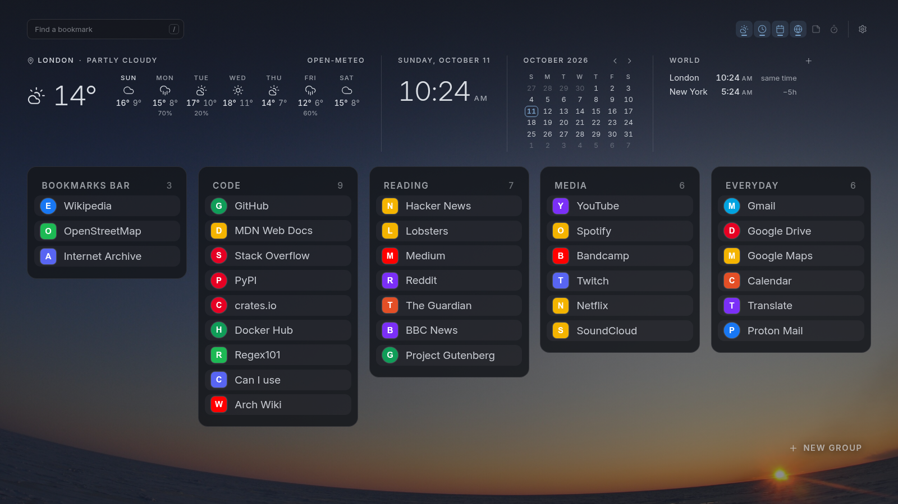

# Mutemark

A new tab page for Chromium browsers and Firefox that shows your bookmarks as a card for each folder.

<picture>
  <source media="(prefers-color-scheme: dark)" srcset="docs/screenshot-dark.png">
  <source media="(prefers-color-scheme: light)" srcset="docs/screenshot-light.png">
  
</picture>

## Your bookmarks never leave your browser

- No account, no analytics, no servers of ours.
- Your bookmarks are read locally and every edit is written to the browser's own bookmarks.
- The only network requests go to two Open-Meteo hosts, only while the weather widget is on and you have chosen a place (or are searching for one). The forecast is refreshed at most every 20 minutes while a new tab is open.
- The extension's Content Security Policy allows `connect-src` for those two hosts and nothing else, so the browser itself blocks any other request.
- Permissions: `bookmarks`, and `favicon` in Chromium. No host permissions.
- Plain HTML, CSS and JavaScript: no bundler, no minification, no libraries. The build script only copies files, merges the manifest and zips, so what you read here is what runs.

## Features

- Bookmarks as cards, one card for each folder, in a masonry-style layout that fits the window and remembers where each card sits. By default the page shows all your bookmarks: the bookmarks bar, then Bookmarks Menu (Firefox), Other bookmarks and Mobile bookmarks, with the bookmarks that sit directly in each of them on a card named after it. A start folder in Settings narrows the page to the bookmarks bar or to one folder, and then the bookmarks that sit directly in it get the first card. Bookmarks in deeper folders join the card of their top folder. A long folder is split into columns inside its card. Few bookmarks get larger rows, many get smaller ones, so the board fills the window without scrolling where it can. An empty folder gets a card that says Drag bookmarks here. A card shows up to 60 bookmarks: for a bigger folder its counter reads, for example, 60 of 75. Search still finds the others: while you type, a card with matches past the 60th shows only its matches. Move some of the others into another folder next to it to see them all the time, the new folder gets a card of its own. Bookmarks with javascript:, data: or place: addresses (bookmarklets, Firefox smart queries) are not shown, and a folder that holds only those gets no card. An ftp: bookmark is shown, but no supported browser opens it, so Mutemark says so.
- Type to search, in the field at the top left, level with the cards. Matches names, addresses, folder names and initials, and also text typed on the wrong keyboard layout. When a new tab opens, the browser keeps the focus in the address bar and the field says Click to search: click the page once, then type.
- Drag and drop to reorder bookmarks or move them between folders. Every change is written to the browser's own bookmarks.
- Right-click a bookmark for Open in new tab, Copy link, Rename and Delete. A deletion can be undone for 10 seconds.
- Groups are bookmark folders. New group, under the right edge of the board, makes a folder in the bookmarks bar (or in the start folder, if you chose one) and asks for its name. Rename a group by double-clicking its title or from its menu. Drag a group by its title to move it. Delete group moves everything in it, subfolders too, into the folder above in the group's place, removes the folder and offers Undo, which puts it all back in the old order. A card with the bookmarks that sit directly in a root (or in the start folder) cannot be renamed, deleted or moved.
- Widgets in the header, each turned on and off with its button in the widget bar at the top right: Weather and Clock (on by default), Calendar, World clocks, Note and Timer. All but the weather work without the network.
  - **Clock:** the time and the date.
  - **Calendar:** a month, with today marked. Click the month's name to come back to the current one.
  - **World clocks:** up to three cities or time zones (London and New York until you choose), each with its offset from your time. The list of zones comes from the browser itself.
  - **Note:** a plain text note, saved as you type and kept in step between open tabs.
  - **Timer:** 5, 15 or 25 minutes, or your own time (`10` or `1:30`), with pause and reset. At the end it rings once, with a single bell strike played in the page by one tab only, without a sound file, a notification or a permission. It works only while a new tab stays open: close the tab and it will not ring. A tab that stays in the background for a long time may ring up to a minute late, because the browser slows its timers.
- Weather: current conditions and a 7-day forecast from Open-Meteo, for a place you choose yourself in the header. A search shows its matches to choose from, even when there is only one. Nothing is requested until you search for or choose a place. Clearing the place field and pressing Enter forgets the place.
- Light and dark themes, an accent color, and a background: one of 28 pictures that ship with the extension (photos from NASA, NPS, USFWS, NOAA and USGS, and public domain paintings and a print from the National Gallery of Art, The Met and the Museum of Fine Arts, Boston; all public domain or CC0), the theme gradient, a solid color or your own image. A veil in the theme color keeps text readable on any of them, and gets stronger when a light picture meets the dark theme or the other way round.

## Settings

Click the gear at the right end of the widget bar, above the header, to open Settings. Every change applies at once, without a reload.

- **Theme:** System (follows the operating system), Light or Dark.
- **Accent:** the theme's own, one of six palette colors, or any color you pick.
- **Background:** a gallery of the bundled pictures (credits in [THIRD_PARTY_NOTICES.md](THIRD_PARTY_NOTICES.md), the chosen one is credited under the gallery with a link to its source), Gradient, Solid, or Your image. Until you choose, it is the photo Curves under the dark theme and Aiguille Rousse in a Sea of Clouds under the light one, or the theme wallpaper in a build made with the [Omarchy script](contrib/omarchy). Your image is chosen from your disk and stored in the extension's IndexedDB in this browser, without its file name. It is never uploaded. Remove deletes it.
- **Start folder** (under More): what the page shows. All bookmarks by default, or the bookmarks bar only, or any folder of your bookmarks. Layouts are remembered for each choice separately.
- **Units and clock:** temperature in °C or °F, wind in m/s, km/h or mph, and a 12-hour or 24-hour clock (12h, 24h) for the clocks and the time of the last weather update. Changing units sends nothing: the forecast is converted in the page. Until you choose the clock, it follows the browser's locale. On a 24-hour clock the hour always has two digits, as in 09:05.
- **More:** import an Omarchy theme (a `colors.toml` or `alacritty.toml` with hex colors, from a terminal or desktop theme). Only the colors and the file's name are kept, not the file. While imported colors are in use, the Theme choice above is set by them. Reset returns to the built-in palette. Also links to [PRIVACY.md](PRIVACY.md), the source code and the Open-Meteo attribution.
- **Delete everything:** deletes everything the extension stored in this browser (settings, widgets, the note, the timer, layouts, the cached page, the place, the forecast and your image) after a confirmation in the panel. Bookmarks are not touched.

On first open a one-line hint points to the widget bar. Closing it, or opening Settings, hides it for good.

The panel works from the keyboard: Tab stays inside it while it is open, Escape closes it and returns to the gear.

## Privacy

Mutemark has no account, no analytics and no servers of its own. Your bookmarks never leave the browser.

- **Read locally.** The extension reads your bookmarks through the browser's bookmarks API, only to draw the page and to apply your edits (move, reorder, delete, undo). Site icons come from the browser's local icon cache (Chromium only).
- **Stored locally.** Settings (including the chosen background, the world clock time zones and, if you imported a theme, its colors and file name), the layout, the note, the timer, a cached copy of the page with your bookmark titles and addresses and, if you use weather, the place you chose and the last forecast are kept in the extension's own `localStorage`, in your browser profile. A background image you add is kept in the extension's own IndexedDB. Nothing is synced or uploaded. Removing the extension or pressing Delete everything in Settings deletes it. [PRIVACY.md](PRIVACY.md) lists every key.
- **The only network requests** go to two Open-Meteo hosts, only while the weather widget is on and you have chosen a place (or are searching for one). Firefox asks for consent to share location data, and without it nothing is sent:
  - `geocoding-api.open-meteo.com`, a place search, when you type a city name and press Enter. It carries the text you typed.
  - `api.open-meteo.com`, the forecast for the place you chose, with its rounded coordinates. It is repeated at most every 20 minutes while a new tab is open.
- **What Open-Meteo sees:** your IP address, the browser's user agent, the headers the browser adds to every request (`Accept-Language` with your browser's languages and, in Chromium, the client hints `Sec-CH-UA`, `Sec-CH-UA-Mobile` and `Sec-CH-UA-Platform` with the browser brand and version, whether it is a mobile browser and the operating system), an `Origin` header with the extension's id (in Firefox, an id made at random for each installation), and either the text you searched or the rounded coordinates. No cookies and no referrer are sent. Coordinates are rounded to two decimals before they are stored or sent, so they are never finer than about 1 km. Coordinates you type into the place field are never sent as a search, whatever digits they are written in (full-width, Arabic and others are read as plain ones): decimal ones (such as `51.51, -0.13`) and degrees, minutes and seconds (such as `51°30'26"N 0°7'39"W`) are rounded and used directly. A Plus Code, a lone decimal number, a number with a sign in front and a few similar forms are not sent either: the field says to use decimal coordinates. Any other text is sent as typed, like a place name, so a position written in another code, such as a geohash, a Maidenhead locator or a what3words address, would reach the geocoder as it is. Mutemark does not detect your location on its own.
- **Browser-enforced guarantee.** The extension's Content Security Policy allows `connect-src` only for those two hosts. The browser itself blocks any other request from the extension pages.

See [PRIVACY.md](PRIVACY.md) for the full policy.

## Browser support

| Browser | Support | Notes |
|---|---|---|
| Chrome, Brave, Edge (Chromium family) | Yes, version 123 or later | Site icons from the local icon cache. |
| Vivaldi | Untested | Chromium based, so it should work. Vivaldi may show its own start page instead of the new tab page. |
| Firefox (desktop) | Yes, version 140 or later | Firefox ESR 140 is supported. No site icons, because Firefox gives extensions no icon cache. Bookmarks show a letter. Nothing is fetched from the sites. |
| Safari | No | Safari has no bookmarks API for extensions. |
| Opera | No | Opera does not allow an extension to replace the new tab page. |
| Firefox for Android | No | Firefox for Android does not allow an extension to replace the new tab page. |

## Install

Download the zip for your browser from the [latest release](https://github.com/stop-loss-enjoyer/mutemark/releases/latest). Store listings may follow later.

**Chrome, Brave, Edge** (Vivaldi should work but is untested)

1. Unzip the Chromium package into a new, empty folder with a fixed name that you keep. The zip has no top-level folder, so name the target: `unzip mutemark-chromium-1.1.0.zip -d mutemark`.
2. Open the browser's extensions page and turn on Developer mode.
3. Choose Load unpacked and select that folder, the one with `manifest.json` directly inside.

Do not move or rename the folder afterwards. The browser ties the extension's settings, note, timer, place and your own image to the folder's path, so a moved folder loads as a new, empty extension.

**Firefox**

Firefox installs only signed extensions, and this one is not signed yet. Until it is published on addons.mozilla.org, there are two ways:

- **Regular Firefox, temporarily.** Open `about:debugging#/runtime/this-firefox`, choose Load Temporary Add-on and select the Firefox zip, or the `manifest.json` inside the unzipped folder. A temporary add-on is removed when Firefox restarts.
- **Firefox Developer Edition, Nightly or an unbranded build, permanently.** Open `about:config`, set `xpinstall.signatures.required` to `false`, then open `about:addons`, choose the gear, Install Add-on From File, and select the Firefox zip. Release and Beta builds ignore this setting. ESR honours it and is supported too (Firefox 140 or later).

To build the packages yourself instead, see Build below.

### First run

The first time you open a new tab, the browser may ask whether to keep the change made by the extension. Choose Keep (in Firefox, Keep changes), because the other choice turns Mutemark off. In Firefox, Mutemark replaces the New Tab page only: the Home page stays as set in Settings, Home.

### Update

- **Chrome, Brave, Edge:** delete the old files in the folder you loaded (otherwise files of the old version stay behind), unzip the new package into that same folder, then press Reload on the extensions page. Do not load the new version from another folder: the browser would treat it as a separate extension, without your settings, note and image.
- **Firefox, permanent install:** open `about:addons`, choose the gear, Install Add-on From File, and select the new zip. It replaces the old version, because the add-on id stays the same.
- **Firefox, temporary install:** load the new zip again from `about:debugging`.

### Uninstall

Remove the extension on the browser's extensions page. This also deletes everything it stored (see Privacy).

## Build

```
./build.sh
```

The script assembles `src/` with the browser-specific manifest overlays and writes unpacked folders and zip packages for Chromium and Firefox into `dist/`. It needs `bash`, `python3` (to merge the manifests), `zip` and GNU coreutils (standard on Linux; on macOS install `coreutils` and put its `gnubin` directory first in `PATH`). For a release, set `SOURCE_DATE_EPOCH` to get byte-identical archives.

## Omarchy integration

An optional script in [contrib/omarchy](contrib/omarchy) copies the colors and wallpaper of the current Omarchy theme into an unpacked build in `dist/`. It is not part of the extension and never ships in the packages. See its README.

## License

PolyForm Noncommercial 1.0.0 (SPDX: `PolyForm-Noncommercial-1.0.0`). See [LICENSE](LICENSE) and [THIRD_PARTY_NOTICES.md](THIRD_PARTY_NOTICES.md). You can use Mutemark, read the code, change it for yourself and pass it on, for any purpose that is not commercial. Commercial use, including selling it or building it into a product that is sold, needs a separate license.

For a commercial license, or to talk about the project itself, write to sl.enjoyer@pm.me

Required Notice: Copyright 2026 stop-loss-enjoyer
